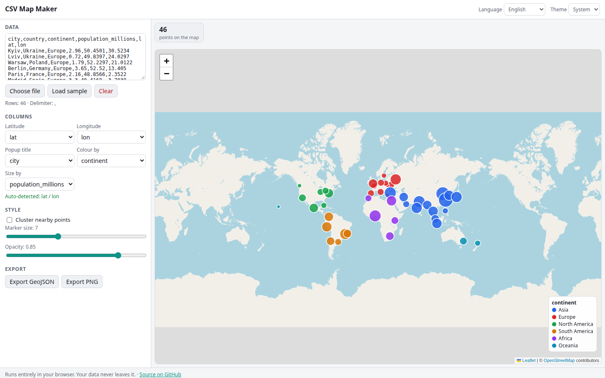

# CSV Map Maker

Paste or upload a CSV with coordinates and get an interactive map in seconds. Latitude and longitude columns are detected automatically, markers can be coloured and sized by any column, nearby points can be clustered, and every marker has a popup with the full row. Export the result as GeoJSON or a PNG image. Everything runs in your browser.

**Try it: [hermes98761234.github.io/csv-map-maker](https://hermes98761234.github.io/csv-map-maker/)**

[](https://github.com/hermes98761234/csv-map-maker/actions/workflows/deploy.yml)



## Features

- **Paste, drop or choose a file.** Delimiter (comma, semicolon, tab, pipe) is detected; quoted fields and multi-line cells are handled.
- **Automatic coordinate detection** from column names (lat, latitude, lng, lon, long, ...) with a value-range fallback. Accepts decimals, decimal commas, hemisphere letters and degrees-minutes-seconds.
- **Colour by column**: categorical palette with a legend, or a viridis ramp for numeric columns.
- **Size by column**: marker area scales with the value.
- **Clustering** of dense points (Leaflet.markercluster).
- **Popups** with a title column and the full row.
- **Export** GeoJSON (lon/lat order, numeric properties) and PNG of the current view.
- English and Ukrainian UI, light/dark/system theme.

## How it works

Leaflet draws OpenStreetMap tiles and canvas circle markers. Parsing, detection, styling and GeoJSON conversion are pure functions in `src/lib` with unit tests. The PNG export redraws the visible tiles and markers on a canvas. Only the OSM tile requests leave your browser; your CSV never does.

## Quick start

```
npm install
npm run dev
npm test
npm run build
```

## License

MIT
